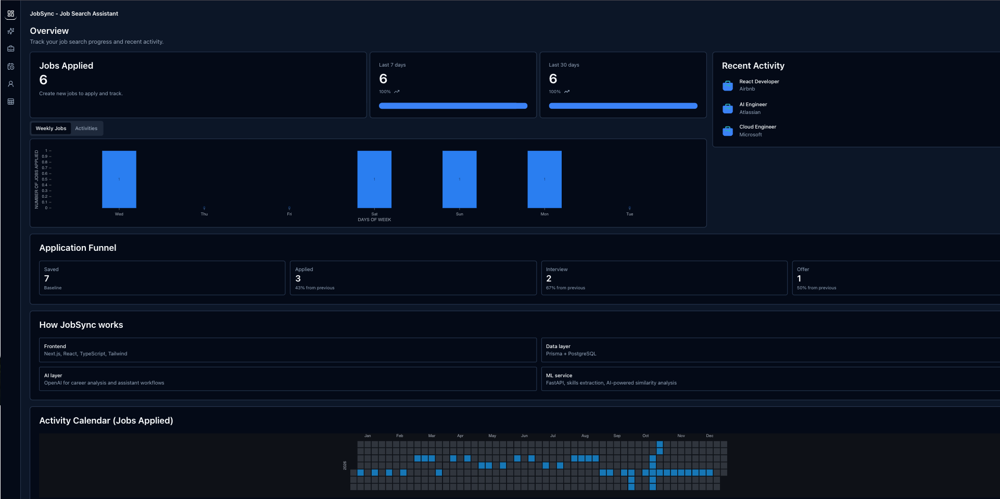
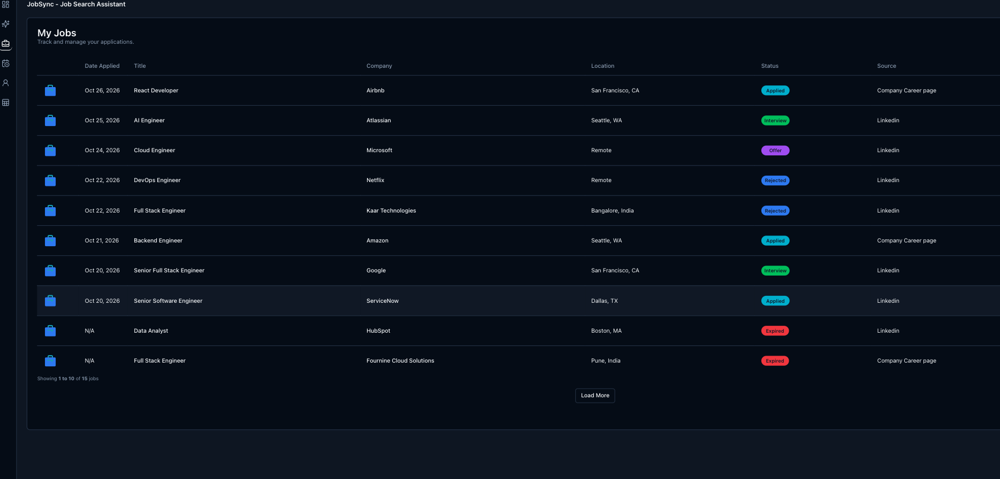
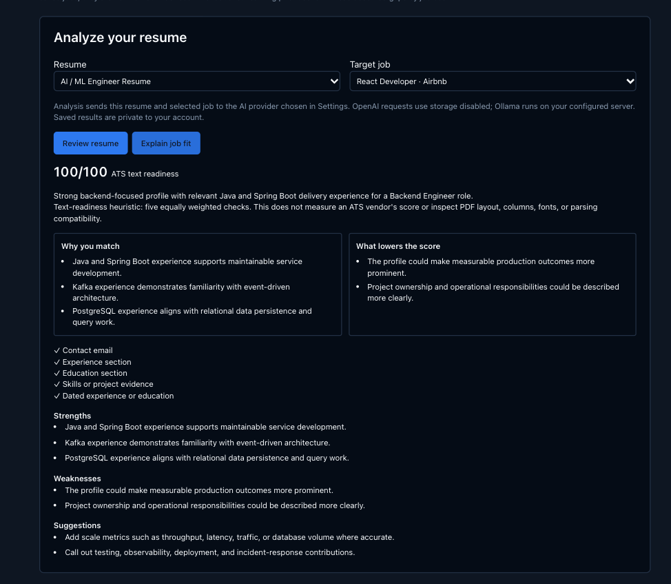
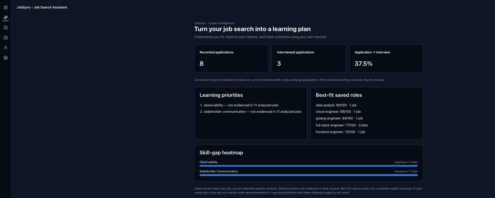
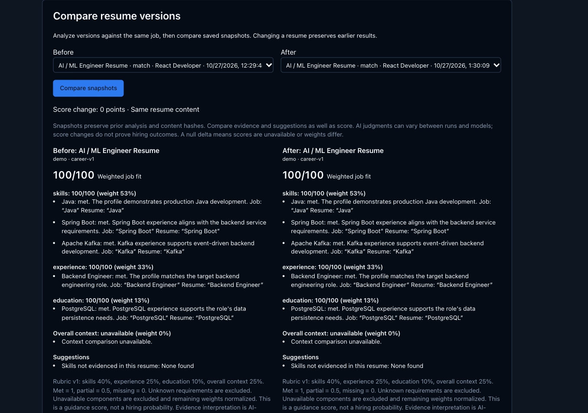
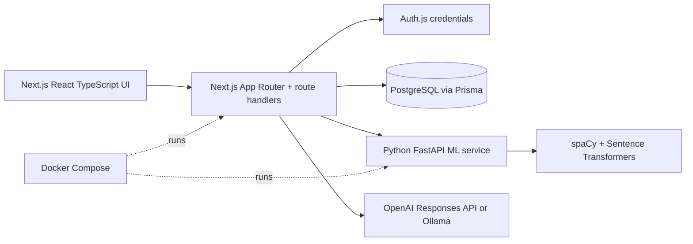
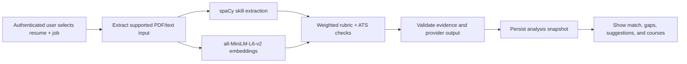

# JobSync — AI Career Intelligence Platform

[](https://nextjs.org/) [](https://www.typescriptlang.org/) [](https://www.postgresql.org/) [](https://fastapi.tiangolo.com/)

## Live Demo

[Open JobSync](https://job-sync-beige.vercel.app/dashboard)

JobSync connects your application tracker, resumes, job requirements, and learning plan. Built on the existing Next.js application: dashboards, jobs, activities, resume builder/PDF uploads, course recommendations, administration, and OpenAI/Ollama settings remain available.



## Application Preview

These screenshots are captured from the implemented JobSync application and focus on its tracking, analysis, and career-intelligence workflows.

| Dashboard | My Jobs |
| --- | --- |
| <br><br>**Dashboard** — Application metrics, recent jobs, activity charts, and the application funnel. | <br><br>**My Jobs** — Job records and application statuses organized in a searchable workspace. |

| Resume Analysis | Career Intelligence |
| --- | --- |
| <br><br>**Resume Analysis** — ATS-style readiness checks, evidence, matching context, and suggestions. | <br><br>**Career Intelligence** — Recorded application outcomes, best-fit roles, skill gaps, and learning priorities. |



**Resume Comparison** — Versioned analysis snapshots compared against the same job context.

## System Architecture

The Next.js application owns authenticated UI, persistence boundaries, and analysis routes. Prisma stores account-scoped records in PostgreSQL, while the private FastAPI service handles PDF/text extraction, spaCy skill extraction, and Sentence Transformer similarity. Optional OpenAI Responses API or Ollama paths provide generated feedback when configured.



## Resume Analysis Workflow



The weighted guidance rubric uses skills 40%, experience 25%, education 10%, and semantic similarity 25%; unavailable components are excluded and remaining weights are normalized. Deterministic checks and scoring are kept distinct from optional LLM-generated feedback, and scores are not hiring probabilities.

## Career Intelligence

Open **Career Intelligence** in the dashboard navigation.

- **Explainable job fit:** skills, experience, education, and semantic similarity; cited job/resume evidence; missing skills; transparent weighted score.
- **Resume analysis:** ATS text-readiness checks, keyword gaps, weak bullets, and suggestions for a selected job.
- **Version comparison:** saved analysis snapshots retain content hashes, model, and rubric. Compare two resume versions under the same job context.
- **Insights:** recurring missing skills, best-fit saved roles, recorded application/interview conversion, and learning priorities.
- **Career assistant:** resume editing, interview preparation, learning, and application strategy grounded in the selected resume, job, and measured insights.

Scores are guidance, not hiring probabilities. ATS readiness is a five-check text heuristic, not a commercial ATS measurement. No accuracy or outcome benchmark is claimed. See [scoring methodology](docs/SCORING.md).

## Stack

Next.js 15 / React 19 / TypeScript, Prisma 6 with PostgreSQL, Auth.js credentials, Tailwind/shadcn UI. Python FastAPI provides skill extraction, PDF text extraction, course recommendations, and Sentence Transformer similarity. OpenAI uses the Responses API with strict structured output and `store: false`; Ollama remains supported.

## Run with Docker

1. Copy `.env.example` to `.env`.
2. Set `POSTGRES_PASSWORD` (use URL-safe characters), a matching `DATABASE_URL`, `AUTH_SECRET` (`openssl rand -base64 33`), and your own `USER_EMAIL` / `USER_PASSWORD` (at least 12 characters). There are no default credentials.
3. Set `OPENAI_API_KEY` to use OpenAI. `OPENAI_MODEL` defaults to `gpt-5-mini` and can be configured by the operator. Alternatively select Ollama in Settings and install `llama3.1` on the configured Ollama server.
4. Run `docker compose up --build -d` and visit `http://localhost:3000`.

PostgreSQL data uses a named volume; resume files remain under `jobsyncdb/data`. The ML service is internal to Compose. Database startup is health-gated. Migrations and idempotent reference/account seeding run before the application starts. For an existing database, **import before starting/seeding the app**: [SQLite migration and rollback](docs/POSTGRESQL.md).

The initial ML build downloads dependencies and model assets. Its first startup may take time. Missing ML similarity is explicitly shown as unavailable; it is not replaced by an invented score.

## Local development

Use Node 22+, PostgreSQL 17, and Python 3.11 for the ML service.

```sh
npm ci
npm run db:generate
npm run db:migrate
npm run seed
npm run dev
```

Configure `.env` first. Node CLI seeding/import scripts need exported environment variables; use `node --env-file=.env prisma/seed.js` when running locally. Prisma and Next load `.env` themselves. Start the Python service using [its README](ml-service/README.md). Run PostgreSQL alone with `docker compose up -d db` if desired.

## Verification

```sh
npm run typecheck
npm run lint
npm run test:ci
npm run build
```

Unit/route tests mock external providers and test arithmetic, unavailable-data handling, evidence validation, ownership, and error boundaries. Live AI quality is not established by mocked tests. Browser tests use explicit `E2E_EMAIL` / `E2E_PASSWORD` in a test environment. See [deployment](docs/DEPLOYMENT.md) and [implementation notes](docs/IMPLEMENTATION.md).

## Privacy and operations

Resume/job content goes to the chosen AI provider only when analysis or assistant requests are made. Saved results contain personal information and are account-scoped. Model output is validated but may still be wrong; evidence citations help users inspect it. Logs avoid prompts, resume bodies, provider responses, and credentials. Back up PostgreSQL and uploaded files together. Use HTTPS and an appropriately configured reverse proxy for public deployment.
